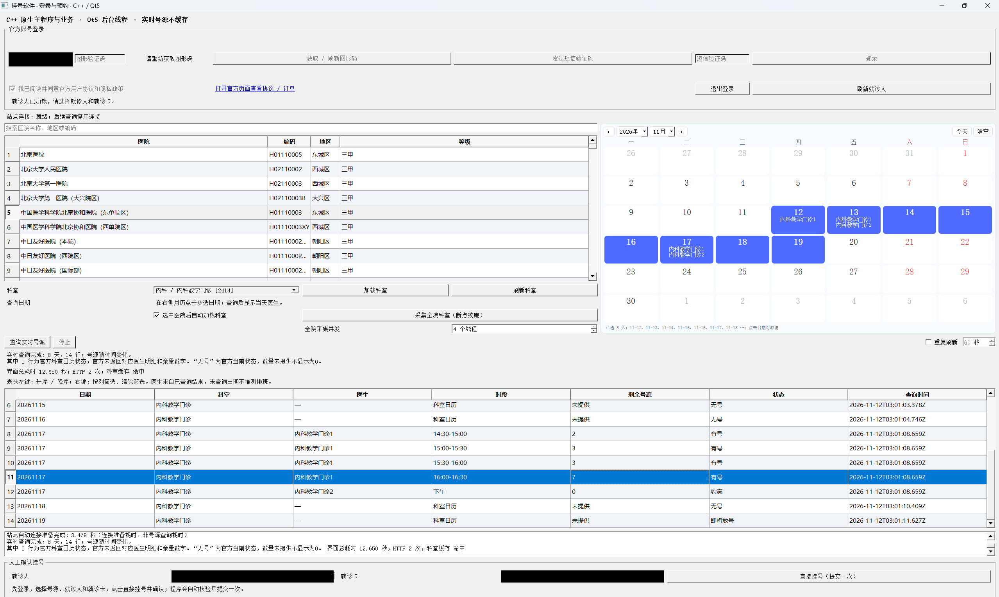

# 辅助挂号软件 v1.1.0

## 免责协议

本软件为非官方辅助工具，供用户本人查询号源并在人工确认后提交一次预约，不保证号源可用或挂号成功。请遵守医院及官方平台规则，核对就诊人、就诊卡、日期、费用及取退号要求；预约和支付结果以官方平台为准。验证码须由本人输入，遇到提交结果未知时请先核对官方订单，勿重复提交。请妥善保护个人信息，勿用于倒号、代抢或其他违规用途。

详细使用边界见 [免责协议](docs/免责协议.md)。这段文字用于说明产品用途与风险，不代表能够免除依法应承担的责任。

## 当前版本

这是辅助挂号软件 v1.1.0 的 C++ / Qt5 源码。上传及打包时排除可执行文件、构建产物、SDK、第三方 DLL、node_modules、会话、抓包和个人就诊资料。

### 已包含的功能

- 按医院名称、地区或编码查找医院，加载本地公开科室目录并查询号源。
- 日历可选择多个查询日期，依次查询并汇总结果；可以停止后续查询。
- 结果表支持排序和多条件筛选。医生范围、日期与可预约行以实际查询及官方核验结果为准。
- 用户手动登录、本人输入验证码，选择就诊人、就诊卡和号源，再经过确认提交一次预约。
- 顶部显示“免责协议”；窗口标题为“辅助挂号软件 v1.1.0”。

当前没有定时提交功能，也不会自动发送短信、自动输入验证码或自动完成支付。请自行核对官方订单，尤其不要在提交结果未知时连续重试。

### 功能示意图

此图来自使用示例，手机号、就诊人、就诊卡已实体遮盖。它仅用于说明功能；标题与布局以 v1.1.0 为准，不能将此图当作新版实际截图。

### 已知限制

- 科室日历行不等同于医生号源；没有实际可预约时段的行不能直接用于预约。剩余号源为空时不会擅自当作 0。
- 本地目录快照包含 308 家医院，仅用于目录加载；实时号源、费用、预约和支付结果均以官方平台为准。
- 离线测试只能验证本地逻辑及模拟输入。本次整理不访问医院站点、不发送短信、不进行真实登录或预约；离线通过不等于站点当前可用。

## 目录

| 路径 | 内容 |
| --- | --- |
| src/ | C++ 主界面、查询服务、预约服务和后端桥接 |
| runtime/ | Node JSONL 子进程、公开请求头和所需兼容模块 |
| data/ | 公开医院 CSV 和科室目录快照 |
| vendor/jsdom/ | 与运行时匹配的 jsdom 31.0.0 源码及 MIT 许可 |
| tests/ | 本地离线回归测试；具体入口以文件为准 |
| AssistedRegistration.pro | Qt qmake 构建配置 |
| build.cmd / run.cmd | Windows 构建与启动入口 |

## 开发环境

- Windows x64；MSVC x64 C++17 工具链与 Windows SDK。
- Qt 5.15 的 MSVC x64 SDK，包含 Core、Gui、Widgets、Network；libcurl 的头文件、链接库和配套运行 DLL。
- Node.js：package.json 声明 ^24.15.0 或 >=26.0.0，本机整理使用 Node 24.16.0。还需通过应用启动时的 V8 能力检查；其他 Node 版本不在本次验证承诺内。
- npm 和 Python 3（Python 仅用于部分源码检查/测试脚本，应用本身不依赖 Python）。

Qt、libcurl、编译器与 Node 的二进制不在源码中。应从各项目的官方渠道自行安装，并遵守各自许可。

## 构建与运行

在 x64 Native Tools Command Prompt 中进入本仓库。将 QT_ROOT 与 CURL_ROOT 设置为各自 SDK 前缀；需要时将 VCVARS64 指向 vcvars64.bat。路径可以按实际安装位置修改：

    set QT_ROOT=C:\Qt\5.15.2\msvc2019_64
    set CURL_ROOT=C:\SDK\curl
    set PATH=%QT_ROOT%\bin;%CURL_ROOT%\bin;%PATH%
    npm ci
    npm run check
    npm run test:crypto
    build.cmd --no-pause
    run.cmd

构建输出为 bin/AssistedRegistration.exe。启动时应保留仓库的 data、runtime 与安装后的 node_modules，或用 --project-root 指定完整项目根目录。不要把 EXE 单独移走。应用优先使用 NODE_EXECUTABLE 指定的 Node，其次使用 runtime/node/node.exe，最后查找 PATH（以 src/runtime_paths.h 为准）。

build.log 用于诊断本机编译错误，不属于发布源码。Windows 运行目录另需匹配的 Qt、libcurl 和 MSVC 运行库；本仓库不将开发机依赖混入源码包。

## 运行时与隐私

booking_route_runtime.cjs、query_runtime.cjs、legacy_readonly_runtime.cjs 来自当前实际使用的运行时，仅调整模块定位以去除开发机路径。helpers 也保留原实现并使用包定位。公开请求头文件只包含 Accept、语言、User-Agent 和 Sec-Fetch 类字段，不包含 Cookie、Authorization、请求正文或个人会话。

手机号加密使用 MIT 开源 sm-crypto 适配器，保持公开公钥、SM2 C1C3C2 格式及 04 点前缀。未重新分发许可不明确的站点压缩加密脚本。合成输入自检不发送网络请求，不代表服务器接受测试密文。

登录和预约需要处理个人信息；不要公开协议日志、Cookie、令牌、手机号、身份证、就诊卡或订单。请在本人控制的环境中使用，不要将敏感文件加入版本控制。

## 开发提交

修改后先运行本地构建、离线测试和源码审计，再检查待提交差异。复用现有仓库的分支和远端，仅暂存本次修改的文件：

    python scripts/check-source-release.py
    git diff --check
    git add PATH_TO_CHANGED_FILE
    git diff --cached --check
    git diff --cached --stat
    git commit -m "Describe the source change"

涉及源码文件变化时，应同步更新 SOURCE_MANIFEST.json 并重新执行审计。提交前确认没有加入个人资料、会话、抓包或构建产物。

## 许可

本项目沿用原 GitHub 仓库的 MIT 许可，见 [LICENSE](LICENSE)。第三方源码及依赖保留各自许可，见 [THIRD_PARTY_NOTICES.md](THIRD_PARTY_NOTICES.md)。MIT 许可并不授予医院名称、数据、商标或官方平台的额外权利，也不构成平台使用授权。
