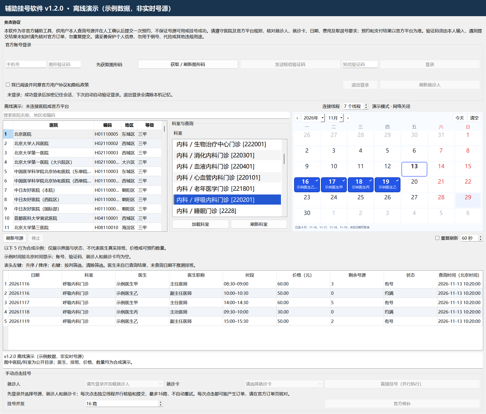

# 辅助挂号软件 v1.2.0

## 免责协议

本软件为非官方辅助工具，供用户本人查询号源并在人工确认后提交一次预约，不保证号源可用或挂号成功。请遵守医院及官方平台规则，核对就诊人、就诊卡、日期、费用及取退号要求；预约和支付结果以官方平台为准。验证码须由本人输入，遇到提交结果未知时请先核对官方订单，勿重复提交。请妥善保护个人信息，勿用于倒号、代抢或其他违规用途。

详细使用边界见 [免责协议](docs/免责协议.md)。这段文字用于说明产品用途与风险，不代表能够免除依法应承担的责任。

## 当前版本

这是辅助挂号软件 v1.2.0 的 C++ / Qt5 源码。本目录仅提供代码、必要公开目录数据和已脱敏示例，不包含真实会话、账号资料、抓包或个人就诊资料；上传及源码打包时也排除可执行文件、构建产物、SDK、第三方 DLL 和 node_modules。

### 已包含的功能

- 按医院名称、地区或编码查找医院，加载本地公开科室目录并查询号源。
- 科室采用可滚动列表，与医院目录并排显示；点击科室或改变日历选择会触发查询，快速连续选择合并为最后一次刷新。
- 日历可选择多个查询日期，使用独立查询线程并行处理适合并行的日期任务并汇总结果；可以停止查询。
- 查询连接数量可设为 1–16，默认 7；界面分别显示配置数量、运行线程、连接就绪与准备中数量。
- 选中医院时后台准备连接，将准备过程与科室、日期选择重叠；查询时仍可能等待剩余准备。
- 空闲时自动补连并轮换备用会话，后台维护最多同时准备 2 个连接，失败后按 2–60 秒退避。
- 结果表支持排序和多条件筛选。医生范围、日期与可预约行以实际查询及官方核验结果为准。
- 同一查询范围增量更新结果，尽量保留选择、滚动位置和筛选；刷新期间或失败后保留的旧行不可用于挂号。
- 本人首次输入验证码登录后，在当前 Windows 用户范围加密保存官方会话；下次启动尝试恢复并经官方校验，退出登录清除本地保存。
- 手动挂号并发可设为 1–16，默认 16。每次明确点击“直接挂号（并行执行）”创建一个独立任务，保留官方核验，每个任务最多一次提交，不自动重试。
- 查询时间按北京时间（UTC+8）显示，格式为 yyyy-MM-dd HH:mm:ss。

当前没有定时提交功能，也不会自动发送短信、自动输入验证码或自动完成支付。会话恢复不等于自动预约；点击挂号前请本人核对所选信息，尤其不要在提交结果未知时连续点击。

### 登录与会话恢复

首次使用仍需本人获取并输入验证码完成登录。成功登录后，程序只将经过约束的官方会话 Cookie 保存到 Windows 当前用户的应用数据目录，使用 CurrentUser DPAPI 加密；不把手机号、验证码、就诊人或就诊卡内容写入此会话文件。源码和分发包均不携带真实会话文件或账号数据。

普通界面启动发现保存的会话时，会尝试一次后台恢复：解密后创建新会话，先经官方用户接口确认，再加载就诊人及就诊卡。无保存文件时不发起恢复登录请求。会话过期或校验失败仍需本人重新登录；不能保证永久登录。

点击退出登录会先清除本地加密会话，远端退出失败也不应继续保留本地登录；若删除失败，界面会明确提示。DPAPI 将恢复范围限制为当前 Windows 用户，不能替代对电脑和账号的保护。请避免同时运行多个实例：另一实例若已独立验证登录，仍可能再次保存其会话。

### 手动并发挂号

“挂号并发”与查询连接数量是两个独立设置。并发任务各自使用本次点击时的号源、就诊人和就诊卡快照；超过上限的手动点击进入等待队列，线程真正结束后再释放名额。登录、验证码及提交前的官方核验不会因并发而省略。

防重复边界是单任务最多一次提交、失效预览不可复用以及忽略同一任务的迟到/重复结果；程序没有跨手动点击的全局相同行去重。再次点击会创建新任务，可能产生另一笔预约请求，因此不要用连续点击代替订单核对。提交失败或结果未知都不会自动重发，也不保证平台端去重。

点击停止会取消任务并清空等待队列；已经发送的请求可能已在服务器完成，请到官方平台核对。会话失效时停止继续派发，重新登录前仍需留意在途任务结果。并发数量不是成功率或网络吞吐量保证。

### 功能示意图

本图由 v1.2.0 的真实 C++ / Qt5 界面离线渲染，展示新版免责协议、医院与科室列表、多选日历、医生职称和价格列、北京时间及手动挂号区域。排班、医生、价格、数量和状态均为合成示例，不代表实时号源；账号、验证码、就诊人及就诊卡为空，未使用真实就诊信息。

### 连接准备与状态

“连接就绪”表示应用本地会话通过了当前预算和时效检查，不是实时 TCP 探活，也不保证下一次请求成功。配置数量和实际就绪数量可能不同；有容量时会保留 1 个备用会话。例如配置 16、查询 7 天时，维护目标为 8 个会话（7 个查询加 1 个备用），而不是始终维持 16 个就绪连接。

后台维护按约 1 秒周期检查，在会话临近时效或使用预算时轮换。批次查询、前台操作或元数据处理期间暂停维护；点击停止会禁用自动补连。补连失败按 2、4、8、16、32、60 秒退避，改变日期不会绕过退避。失败的业务查询和订单不会由补连机制自动重发。

DNS 使用应用内共享解析任务和地址缓存，并在后台刷新；不修改系统 DNS 设置，TLS 仍验证原始主机名。没有成功缓存时仍需等待实际系统解析，冷启动或网络异常可能较慢。本版本不承诺固定低于 1 秒完成，也不承诺连接始终就绪。

### 已知限制

- 科室日历行不等同于医生号源；没有实际可预约时段的行不能直接用于预约。剩余号源为空时不会擅自当作 0。
- 增量刷新只保留显示上下文，始终同步剩余号源、查询时间及状态；刷新失败保留的行属于旧数据，不可据此挂号。切换医院或科室会清除不再适用的结果。
- 本地目录快照包含 308 家医院，仅用于目录加载；实时号源、费用、预约和支付结果均以官方平台为准。
- 离线测试只能验证本地逻辑及模拟输入，不能证明站点当前可用。本版没有进行真实账号恢复或真实预约提交测试，也未在全新 Windows 虚拟机中测试；网络、平台状态和剩余准备会影响实际耗时。

## 目录

| 路径 | 内容 |
| --- | --- |
| src/ | C++ 主界面、查询服务、预约服务和后端桥接 |
| runtime/ | Node JSONL 子进程、公开请求头和所需兼容模块 |
| data/ | 公开医院 CSV 和科室目录快照 |
| vendor/jsdom/ | 与运行时匹配的 jsdom 31.0.0 源码及 MIT 许可 |
| tests/ | 本地离线回归测试；具体入口以文件为准 |
| AssistedRegistration.pro | Qt qmake 构建配置 |
| build.cmd / run.cmd | Windows 构建与启动入口 |

## 开发环境

- Windows x64；MSVC x64 C++17 工具链与 Windows SDK。
- Qt 5.15 的 MSVC x64 SDK，包含 Core、Gui、Widgets、Network；libcurl 的头文件、链接库和配套运行 DLL。
- Node.js：package.json 声明 ^24.15.0 或 >=26.0.0，本机整理使用 Node 24.16.0。还需通过应用启动时的 V8 能力检查；其他 Node 版本不在本次验证承诺内。
- npm 和 Python 3（Python 仅用于部分源码检查/测试脚本，应用本身不依赖 Python）。

Qt、libcurl、编译器与 Node 的二进制不在源码中。应从各项目的官方渠道自行安装，并遵守各自许可。

## 构建与运行

在 x64 Native Tools Command Prompt 中进入本仓库。将 QT_ROOT 与 CURL_ROOT 设置为各自 SDK 前缀；需要时将 VCVARS64 指向 vcvars64.bat。路径可以按实际安装位置修改：

    set QT_ROOT=C:\Qt\5.15.2\msvc2019_64
    set CURL_ROOT=C:\SDK\curl
    set PATH=%QT_ROOT%\bin;%CURL_ROOT%\bin;%PATH%
    npm ci
    npm run check
    npm run test:crypto
    build.cmd --no-pause
    run.cmd

构建输出为 bin/AssistedRegistration.exe。启动时应保留仓库的 data、runtime 与安装后的 node_modules，或用 --project-root 指定完整项目根目录。不要把 EXE 单独移走。应用优先使用 NODE_EXECUTABLE 指定的 Node，其次使用 runtime/node/node.exe，最后查找 PATH（以 src/runtime_paths.h 为准）。

build.log 用于诊断本机编译错误，不属于发布源码。Windows 运行目录另需匹配的 Qt、libcurl 和 MSVC 运行库；本仓库不将开发机依赖混入源码包。

Windows x64 完整运行包提供 Qt、Node 与所需依赖。完整解压并保留 DLL、platforms、data、runtime、node_modules 等随附文件，再双击“辅助挂号软件 v1.2.0.exe”；不要只移动 EXE。运行包不包含真实账号或会话。

## 运行时与隐私

booking_route_runtime.cjs、query_runtime.cjs、legacy_readonly_runtime.cjs 来自当前实际使用的运行时，仅调整模块定位以去除开发机路径。helpers 也保留原实现并使用包定位。公开请求头文件只包含 Accept、语言、User-Agent 和 Sec-Fetch 类字段，不包含 Cookie、Authorization、请求正文或个人会话。

手机号加密使用 MIT 开源 sm-crypto 适配器，保持公开公钥、SM2 C1C3C2 格式及 04 点前缀。未重新分发许可不明确的站点压缩加密脚本。合成输入自检不发送网络请求，不代表服务器接受测试密文。

登录和预约需要处理个人信息；不要公开协议日志、Cookie、令牌、手机号、身份证、就诊卡或订单。请在本人控制的环境中使用，不要将敏感文件加入版本控制。

使用后产生的 official-session/session.dpapi 位于当前用户应用数据目录，是个人会话材料；即使已加密也不得加入源码或运行包。退出登录用于清除本地保存，不能将加密或并发保护表述为“零风险”。

## 开发提交

修改后先运行本地构建、离线测试和源码审计，再检查待提交差异。复用现有仓库的分支和远端，仅暂存本次修改的文件：

    python scripts/check-source-release.py
    git diff --check
    git add PATH_TO_CHANGED_FILE
    git diff --cached --check
    git diff --cached --stat
    git commit -m "Describe the source change"

涉及源码文件变化时，应同步更新 SOURCE_MANIFEST.json 并重新执行审计。提交前确认没有加入个人资料、会话、抓包或构建产物。

## 许可

本项目沿用原 GitHub 仓库的 MIT 许可，见 [LICENSE](LICENSE)。第三方源码及依赖保留各自许可，见 [THIRD_PARTY_NOTICES.md](THIRD_PARTY_NOTICES.md)。MIT 许可并不授予医院名称、数据、商标或官方平台的额外权利，也不构成平台使用授权。
